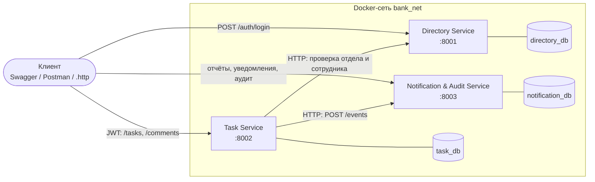
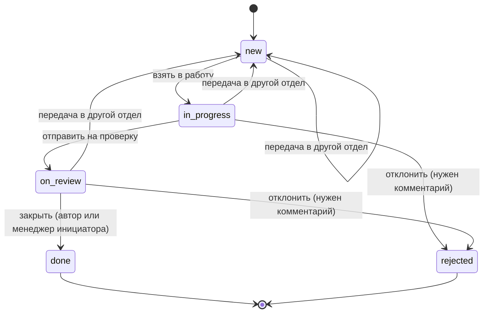
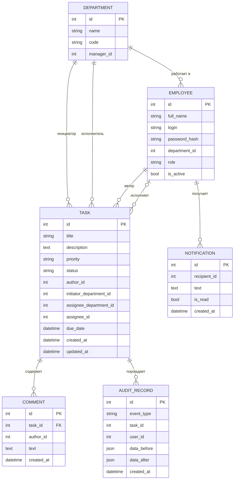

# Задание: система управления задачами между отделами банка

## Цель

Разработать backend из трёх микросервисов на Python, которые помогают отделам банка (кредитный, комплаенс, операционный, ИТ и др.) ставить друг другу задачи, отслеживать их выполнение и сохранять историю изменений. Всё запускается в Docker одной командой.

## Общие требования

- Язык: Python 3.11+, фреймворк FastAPI (допускается Flask).
- Три независимых сервиса. Каждый имеет свой Dockerfile, свой порт и своё хранилище.
- Запуск: `docker compose up --build`.
- Сервисы общаются друг с другом только через HTTP API, а не через общие файлы.
- Код разбит на слои: `api` (эндпоинты), `services` (бизнес-логика), `repositories` (работа с хранилищем), `schemas` (модели Pydantic).
- Бизнес-логика пишется отдельными небольшими функциями. Дублирования кода быть не должно.
- Настройки (порты, адреса сервисов, пути к данным) задаются в `.env`, а не в коде.
- Автотесты в задании не требуются.

Ниже четыре схемы в Mermaid для `README.md`. GitHub и GitLab показывают блоки ` ```mermaid ` как диаграммы без дополнительных настроек.

Архитектура и взаимодействие сервисов



Жизненный цикл статусов задачи



Модель данных ER-диаграмма



## Как добавить в README

Вставьте каждый блок в нужный раздел, например:

- схема 1 в раздел «Архитектура»;
- схема 2 в раздел «Взаимодействие сервисов»;
- схема 3 в раздел «Бизнес-логика»;
- схема 4 в раздел «Модель данных».

Порты (`8001`–`8003`) и название сети `bank_net` замените на те, что указаны в вашем `docker-compose.yml`. Если нужно, добавлю диаграмму для бонусной части с RabbitMQ или Redis, где Task Service публикует события в очередь, а Notification Service их читает.
## Сервисы

### 1. Task Service (порт 8001)

Основной сервис, который отвечает за задачи.

- Создание, просмотр, изменение и закрытие задачи.
- Поля задачи: `id`, `title`, `description`, `from_department`, `to_department`, `assignee`, `priority` (low, medium, high, critical), `status`, `deadline`, `created_at`.
- Статусы: `new` → `in_progress` → `on_review` → `done`. Также допускается `rejected`. Недопустимые переходы между статусами должны отклоняться.
- Фильтрация списка по отделу, статусу, приоритету и исполнителю.
- При создании задачи и смене статуса сервис отправляет события в Notification Service и Audit Service.
- Если эти сервисы недоступны, Task Service не должен падать. Он логирует ошибку и продолжает работу.

### 2. Notification Service (порт 8002)

Сервис уведомлений.

- Принимает события от Task Service (`task_created`, `status_changed`, `deadline_near`).
- Формирует уведомление для нужного отдела или сотрудника и сохраняет его.
- `GET /notifications?department=...` возвращает уведомления отдела.
- `POST /notifications/{id}/read` помечает уведомление прочитанным.
- Отправку имитируем записью в лог и в хранилище. Реальные письма или SMS не нужны.

### 3. Audit Service (порт 8003)

Сервис журнала аудита. В банке важно знать, кто и когда изменил задачу.

- Принимает события и записывает их в журнал: `task_id`, `action`, `actor`, `old_value`, `new_value`, `timestamp`.
- Журнал только дополняется. Эндпоинтов на изменение и удаление записей быть не должно.
- `GET /audit?task_id=...` возвращает историю по задаче, `GET /audit?actor=...` возвращает действия сотрудника.

## Хранилище данных

Выберите один из двух вариантов. Для каждого сервиса используйте своё хранилище.

### Вариант А. Локальное хранилище в JSON (проще, рекомендуется для старта)

Данные лежат в файле, например `/data/tasks.json`. Файл подключается как Docker volume, чтобы данные не терялись при перезапуске контейнера.

Правила работы с JSON-файлом:

1. Весь доступ к файлу сосредоточен в одном классе в слое `repositories`. Остальной код не знает, как устроено хранилище.
2. Запись делайте атомарной: пишите во временный файл, затем заменяйте основной через `os.replace`. Тогда при сбое файл не будет повреждён.
3. Защищайте операции блокировкой `threading.Lock`, чтобы два запроса не писали одновременно.
4. Для журнала аудита используйте формат JSON Lines. Каждая запись добавляется новой строкой в режиме `"a"`, и старые строки не перезаписываются.

Пример репозитория:

```python
import json
import os
import threading
from pathlib import Path


class JsonRepository:
    def __init__(self, path: str):
        self._path = Path(path)
        self._lock = threading.Lock()
        self._path.parent.mkdir(parents=True, exist_ok=True)
        if not self._path.exists():
            self._write([])

    def _read(self) -> list[dict]:
        with open(self._path, encoding="utf-8") as f:
            return json.load(f)

    def _write(self, items: list[dict]) -> None:
        tmp = self._path.with_suffix(".tmp")
        with open(tmp, "w", encoding="utf-8") as f:
            json.dump(items, f, ensure_ascii=False, indent=2, default=str)
        os.replace(tmp, self._path)

    def get_all(self) -> list[dict]:
        with self._lock:
            return self._read()

    def get_by_id(self, item_id: str) -> dict | None:
        return next((i for i in self.get_all() if i["id"] == item_id), None)

    def add(self, item: dict) -> dict:
        with self._lock:
            items = self._read()
            items.append(item)
            self._write(items)
        return item

    def update(self, item_id: str, changes: dict) -> dict | None:
        with self._lock:
            items = self._read()
            for item in items:
                if item["id"] == item_id:
                    item.update(changes)
                    self._write(items)
                    return item
        return None
```

### Вариант Б. SQL (SQLite)

SQLite встроена в Python (модуль `sqlite3`). Отдельный сервер БД не нужен, база хранится в одном файле `/data/tasks.db` на Docker volume.

Краткая инструкция:

1. Подключение и создание таблицы:

```python
import sqlite3

def get_connection(path: str) -> sqlite3.Connection:
    conn = sqlite3.connect(path)
    conn.row_factory = sqlite3.Row  # строки доступны как словари
    return conn

def init_db(conn: sqlite3.Connection) -> None:
    conn.execute("""
        CREATE TABLE IF NOT EXISTS tasks (
            id              TEXT PRIMARY KEY,
            title           TEXT NOT NULL,
            description     TEXT,
            from_department TEXT NOT NULL,
            to_department   TEXT NOT NULL,
            assignee        TEXT,
            priority        TEXT NOT NULL DEFAULT 'medium',
            status          TEXT NOT NULL DEFAULT 'new',
            deadline        TEXT,
            created_at      TEXT NOT NULL
        )
    """)
    conn.commit()
```

2. Основные запросы. Значения всегда передавайте через `?`, а не склеивайте в строку, иначе возможна SQL-инъекция:

```python
# Добавление
conn.execute(
    "INSERT INTO tasks (id, title, from_department, to_department, created_at) "
    "VALUES (?, ?, ?, ?, ?)",
    (task_id, title, from_dep, to_dep, created_at),
)
conn.commit()

# Выборка с фильтром
rows = conn.execute(
    "SELECT * FROM tasks WHERE to_department = ? AND status = ?",
    (department, status),
).fetchall()

# Обновление статуса
conn.execute("UPDATE tasks SET status = ? WHERE id = ?", (new_status, task_id))
conn.commit()
```

3. Для Audit Service создайте таблицу только с `INSERT` и `SELECT`. Дополнительно можно добавить триггер, запрещающий `UPDATE` и `DELETE`:

```sql
CREATE TRIGGER IF NOT EXISTS audit_no_update
BEFORE UPDATE ON audit_log
BEGIN SELECT RAISE(ABORT, 'audit log is immutable'); END;
```

Какой бы вариант вы ни выбрали, слой `services` должен работать только с интерфейсом репозитория (`add`, `get_by_id`, `get_all`, `update`) и не знать, где лежат данные.

## Docker

- В корне проекта лежит `docker-compose.yml`, который поднимает все три сервиса.
- У каждого сервиса есть свой `Dockerfile` на базе `python:3.11-slim`.
- Для каждого сервиса реализован эндпоинт `GET /health` и настроен `healthcheck` в compose. В slim-образе нет `curl`, поэтому проверку можно сделать через Python.
- Task Service стартует после того, как Notification и Audit стали `healthy` (`depends_on` с `condition: service_healthy`).
- Данные хранятся в volumes (`./data/tasks:/data` и т. д.).
- Все настройки лежат в `.env`. В репозитории должен быть `.env.example`.

## Что сдать

1. Исходный код в Git-репозитории.
2. Работающий `docker compose up --build`.
3. README с описанием архитектуры, схемой взаимодействия сервисов, инструкцией по запуску и примерами запросов (`curl` или Swagger).
4. Документация API. Достаточно автоматического Swagger на `/docs`, плюс примеры в README.

